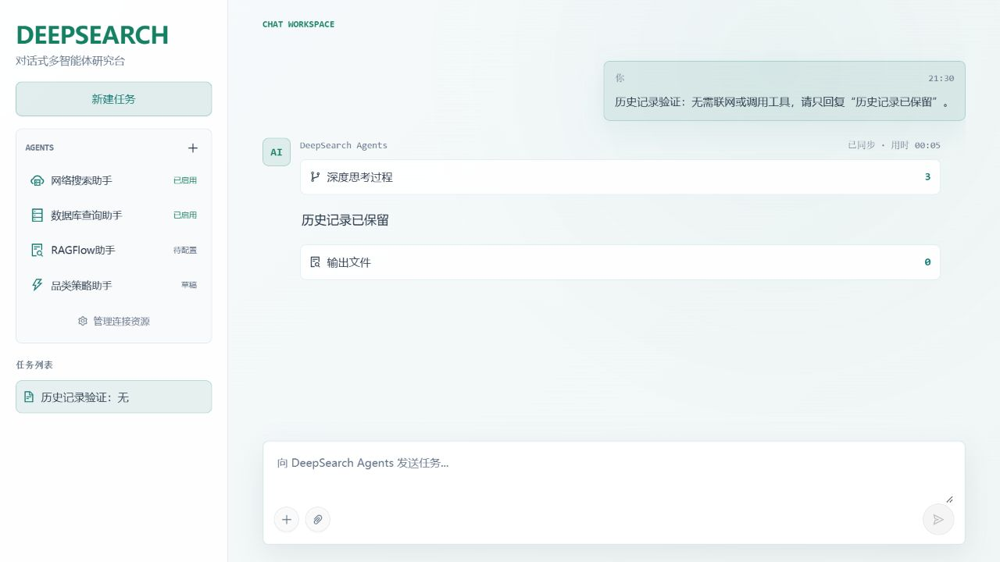

# DEEPSEARCH Platform

**让好奇化为行动，让探索通向答案。**

一个可在本机运行的多 Agent 研究平台：通过对话提交任务，由主 Agent 调度已启用的助手，完成联网搜索、内部知识查询、文件分析和报告生成。

本项目基于 [didilili/deepsearch-agents](https://github.com/didilili/deepsearch-agents) 修改，使用 Python / FastAPI 后端与 React / Vite 前端。



## 已实现的功能

| 功能 | 当前行为 |
| --- | --- |
| 对话与任务列表 | 每次提交生成独立任务条目，以问题前 8 个字符命名；点击可查看对应对话。 |
| 历史记录 | 保存问题、全部监控事件、最终答案与输出文件入口；刷新和后端重启后可恢复。 |
| 侧栏滚动 | 任务列表位于 AGENTS 下方，随整个侧栏滚动；每页加载 50 条，不设固定总条数上限。 |
| 思考过程 | 动态展示理解问题、调度工具与汇总答案阶段；工具结果简洁展示，完整答案出现后自动收起详细过程。 |
| 阅读位置 | 手动向上阅读时暂停自动跟随，滚动回底部后恢复跟随新内容。 |
| Agent 管理 | 新建、复制助手，编辑白盒提示词、输入输出、知识库、Skill 与 MCP 连接。 |
| 配置发布 | 保存草稿、预览生效提示词、测试、启用、停用和恢复历史版本；运行任务固定启动时的配置版本。 |
| 联网搜索 | 使用 Exa，支持来源链接、摘录与按需读取正文。 |
| 知识库 | 已实现 RAGFlow HTTP 连接，通过所选聊天助手查询其关联知识库。 |
| Skill / MCP | 导入 UTF-8 Markdown / ZIP 技能包；连接 MCP HTTP、SSE、stdio，并选择允许调用的具体工具。 |
| 文件与交付 | 上传任务附件、读取文件、生成 Markdown / PDF，并下载任务输出文件。 |

## 环境要求

- Python **3.12**；Python 依赖由 `uv.lock` 与 `requirements-locked.txt` 固定。
- Node.js **24**、pnpm **10.33.0**。
- 实际执行任务需要可用的大模型 API；联网搜索还需要 Exa API Key。
- RAGFlow、MySQL 和 MCP 服务按任务需要配置。仅启动界面无需先部署这些外部服务。

## 快速启动：Windows

### 1. 获取代码

```powershell
git clone https://github.com/limei212/DEEPSEARCH-Platform.git
cd DEEPSEARCH-Platform
```

私有仓库需要使用有访问权限的 GitHub 账号，也可通过仓库的 **Code → Download ZIP** 下载并解压。

### 2. 安装后端并填写配置

使用已安装的 [uv](https://docs.astral.sh/uv/)：

```powershell
uv sync --frozen
if (!(Test-Path .env)) { Copy-Item .env.example .env }
```

没有 uv 时，也可以使用 Python 3.12 与 pip：

```powershell
py -3.12 -m venv .venv
.\.venv\Scripts\python.exe -m pip install -r requirements-locked.txt
if (!(Test-Path .env)) { Copy-Item .env.example .env }
```

在项目根目录 `.env` 中填写模型和搜索配置。例如，使用本项目已联调的 DeepSeek + Exa：

```dotenv
OPENAI_BASE_URL=https://api.deepseek.com
OPENAI_API_KEY=填写你的DeepSeek_API_Key
LLM_QWEN_MAX=deepseek-flash
EXA_API_KEY=填写你的Exa_API_Key
```

`LLM_QWEN_MAX` 是沿用的环境变量名称，可填写所用服务支持的模型 ID。其他兼容接口模型也可通过相应服务地址、密钥和模型 ID 配置。

### 3. 启动后端

在项目根目录执行，并保持终端运行：

```powershell
$env:PYTHONUTF8='1'
.\.venv\Scripts\python.exe -m uvicorn app.api.server:app --host 127.0.0.1 --port 8000
```

修改 `.env` 中的模型或搜索密钥后，需要重启后端。

### 4. 启动前端

另开一个 PowerShell，在项目根目录执行：

```powershell
npm.cmd install -g pnpm@10.33.0
cd frontend
pnpm.cmd install --frozen-lockfile
if (!(Test-Path .env.local)) { Copy-Item .env.example .env.local }
pnpm.cmd dev:compat
```

| 页面 | 本机地址 |
| --- | --- |
| 前端 | <http://127.0.0.1:5173/> |
| 后端接口文档 | <http://127.0.0.1:8000/docs> |

`dev:compat` / `build:compat` 使用 npm 官方 `esbuild-wasm`，适合本项目的 Windows 兼容运行方式；原生 esbuild 可正常运行时，也可使用 `pnpm dev` / `pnpm build`。

macOS / Linux 将 `.venv\Scripts\python.exe` 改为 `.venv/bin/python`，复制文件使用 `cp`，Node 命令去掉 `.cmd`。

## Agent 与资源配置

1. 点击左侧 **AGENTS → ＋**，创建空白助手或复制已有助手。
2. 设置助手名称、能力描述、完整系统提示词以及输入输出要求。
3. 在 **管理连接资源** 中新增知识库、Skill 或 MCP，并测试连接。
4. 回到 Agent 详情页，选择允许查询的聊天助手、可加载的 Skill、可调用的 MCP 工具。
5. 保存草稿、查看生效预览、执行助手测试，然后 **保存并启用**。

主 Agent 根据能力描述调度已启用的助手；草稿不会直接参与研搜。助手测试会调用实际配置的模型与工具。

### 知识库接入状态

| 服务 | 当前状态 |
| --- | --- |
| RAGFlow | 已实现连接器；需要先在 RAGFlow 中配置模型、知识库、文档解析和聊天助手，再到本项目保存并测试连接。 |
| LightRAG | 可作为替代方案参考，当前仓库尚未实现连接器，也不包含其运行环境。 |
| AnythingLLM | 可作为 Windows 桌面知识库方案参考，当前仓库尚未实现连接器。 |

RAGFlow 连接器使用 `/api/v1/chats/{chat_id}/completions` 等 0.x 接口。RAGFlow 1.0 更改了相关接口，需要适配后再使用。知识库连接应填写 RAGFlow 服务地址和它自己的 API Key，并在 Agent 中选择该服务的聊天助手。

参考：[RAGFlow 文档](https://ragflow.io/docs) · [RAGFlow 接口变更](https://ragflow.io/docs/http_api_reference) · [LightRAG](https://github.com/HKUDS/LightRAG) · [AnythingLLM](https://github.com/Mintplex-Labs/anything-llm)。

Skill 首版支持展开后最多 5MB / 100 个 UTF-8 文本文件；附属脚本作为文本读取，不会自动执行。MCP stdio 命令在 Python 后端所在电脑运行。

完整操作说明见 [助手管理说明](docs/助手管理使用说明.txt)。

## 历史记录、备份与迁移

| 路径 | 用途 |
| --- | --- |
| `.env` | 模型、Exa 及可选外部服务的本机配置。 |
| `.agent-data/config.sqlite3` | Agent 配置、资源连接与历史版本。 |
| `.agent-data/secrets.key` | 解密已保存资源密钥所需的本地密钥。 |
| `.agent-data/tasks.sqlite3` | 任务问题、状态、完整监控事件、答案与输出目录入口。 |
| `app/output/` | 任务生成的交付文件。 |
| `app/updated/` | 上传的任务附件。 |

刷新网页不会取消后台任务。后端重启后，未完成任务会标记为中断，保留已有过程，需要重新提交才能继续执行。任务历史功能启用前已经清空的网页内存记录无法恢复。

迁移已有配置与历史时，先停止后端，再单独备份上述运行文件。`.agent-data` 应整体迁移，数据库与 `secrets.key` 必须配套。交付文件入口含绝对路径，迁移到不同项目目录时还需要处理这些路径；复制数据库本身不会自动重写文件路径。

GitHub 与源码 ZIP 不包含真实密钥、本机数据库、用户附件、输出记录、依赖目录或运行日志。

## 验证与构建

```powershell
# 项目根目录
.\.venv\Scripts\python.exe -m unittest discover -s tests -v

# frontend 目录
pnpm.cmd test
pnpm.cmd build:compat
```

2026-10-14 上传前验证：**41 项后端测试、19 项前端测试及前端生产构建通过**。DeepSeek + Exa 已完成真实研搜联调。RAGFlow 与 MCP 协议由自动化测试覆盖；实际内部 RAGFlow、MySQL 或远程 MCP 服务仍需配置后单独联调。

当前启动方式用于本机开发。上传 GitHub 不等于部署公网网站；远程服务还需要独立配置域名、访问控制、HTTPS 和前后端地址。

## 项目结构

```text
app/agent/          主 Agent、提示词和助手调度
app/api/            HTTP / WebSocket、执行监控、任务历史
app/management/     Agent 配置、版本、资源连接与运行时
app/tools/          Exa、数据库、文件及报告工具
frontend/src/      对话、任务列表、Agent 编辑器与资源中心
frontend/tests/    前端状态与交互逻辑测试
tests/             后端、连接器与任务历史测试
docs/              操作说明、教程资料与截图
```

更多安装细节见 [项目运行说明](项目运行说明.txt)。

## 上游与教程

原始项目：[didilili/deepsearch-agents](https://github.com/didilili/deepsearch-agents)。本版本基于提交 `d0f6eed1e14b1b457942ba2a0195f65731aaf444` 修改，保留上游示例和教程资料。

- [AI 智能体实战速成指南](https://github.com/didilili/ai-agents-from-zero)
- [上游在线教程](https://didilili.github.io/ai-agents-from-zero/)
