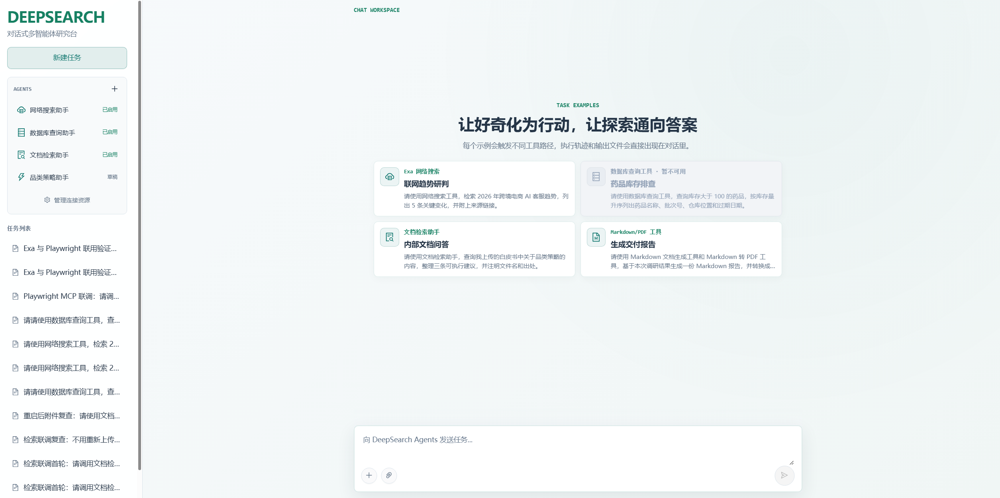
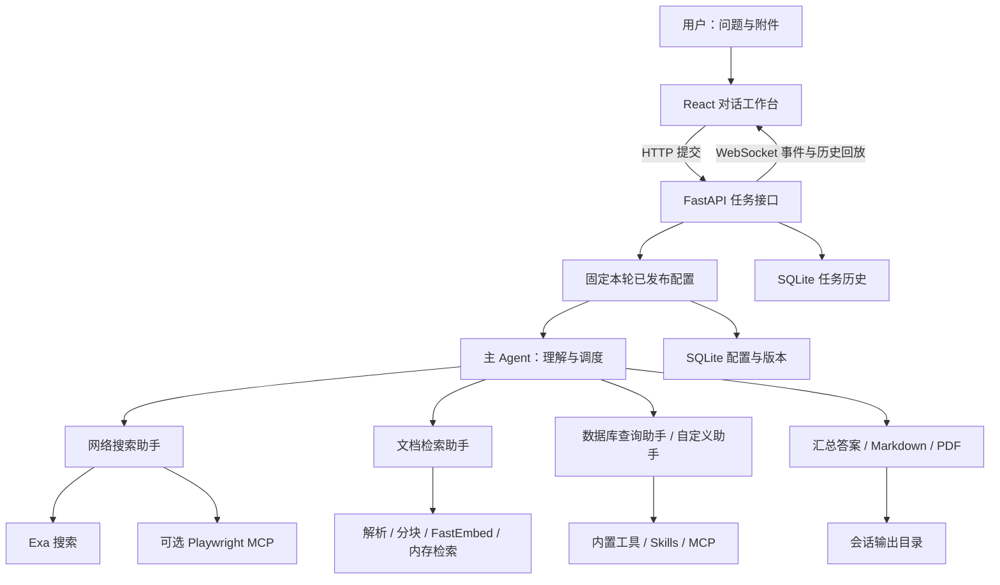
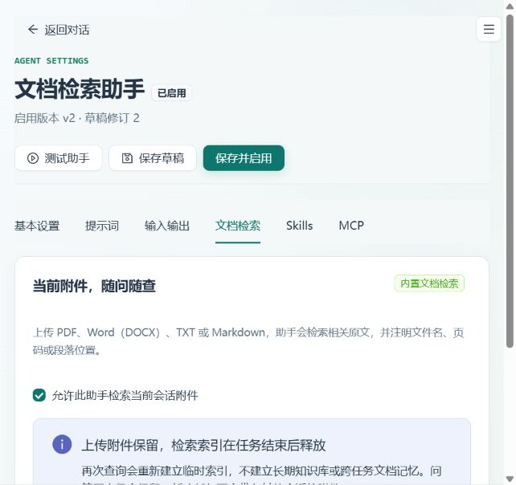
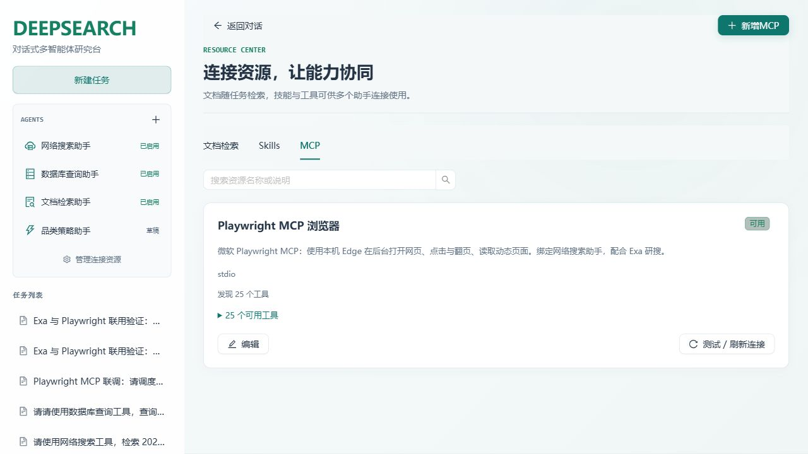

# DEEPSEARCH Platform

**让好奇化为行动，让探索通向答案。**

DEEPSEARCH Platform 是一个以对话为入口的多 Agent 研究工作台，将联网搜索、网页浏览、文档检索和报告生成组织在同一条任务流程中。用户描述目标、上传资料，由主 Agent 理解任务并调度专业助手，最终交付带有依据的答案与可下载的文件。

平台提供可视化的 Agent 配置与资源管理：系统提示词、输入输出约定、Skill 和 MCP 工具均可查看、编辑和测试。执行过程、配置版本、任务历史与附件可以在本机管理，适合个人研究、内部资料分析和多 Agent 工作流的开发验证。



## 目录

- [平台能力](#平台能力)
- [架构与执行流程](#架构与执行流程)
- [技术栈](#技术栈)
- [快速启动](#快速启动)
- [配置说明](#配置说明)
- [使用指南](#使用指南)
- [Agent 配置与发布](#agent-配置与发布)
- [文档检索与附件生命周期](#文档检索与附件生命周期)
- [Skills 与 MCP](#skills-与-mcp)
- [内置工具与数据库](#内置工具与数据库)
- [历史记录与数据管理](#历史记录与数据管理)
- [接口概览](#接口概览)
- [测试与构建](#测试与构建)
- [部署与适用边界](#部署与适用边界)
- [常见问题](#常见问题)
- [项目结构](#项目结构)
- [项目来源与致谢](#项目来源与致谢)

## 平台能力

| 能力 | 功能说明 |
| --- | --- |
| 多 Agent 协作 | 主 Agent 根据问题与助手能力描述，调度已启用的专业助手，整合结果并生成答案。 |
| 联网研究 | Exa 搜索公开信息，返回来源链接与摘录；需要时进一步获取正文。 |
| 网页浏览 | 可连接 Playwright MCP，打开页面、点击、输入、等待动态内容、读取页面快照。 |
| 上传文档问答 | 对 PDF、DOCX、TXT、Markdown 进行本地语义检索，返回文件名与来源位置。 |
| 报告交付 | 生成 Markdown，并通过 ReportLab 转换为 PDF；在对话中查看、下载输出文件。 |
| 白盒 Agent 配置 | 编辑完整提示词、模型、输入字段、输出格式、文档检索、Skill 和 MCP 绑定。 |
| 配置版本 | 草稿、提示词预览、实际测试、启用、停用、历史版本查看与恢复。 |
| 资源中心 | 管理文档检索说明、导入 Skills、配置 MCP 连接，并测试连接与发现工具。 |
| 执行可视化 | 显示助手调度、工具调用、返回结果和错误；动态展示任务阶段。 |
| 持久任务历史 | 保存每次提交的问题、状态、执行事件、最终答案及输出入口，支持刷新恢复。 |
| 连续阅读 | 手动上翻时暂停自动跟随；完整答案出现后收起详细过程，仍可手动展开。 |
| 可选数据库查询 | 提供 MySQL 表发现与查询工具，连接已有数据库；首页“日用品库存排查”示例置灰并标注“即将上线”。 |

适用场景包括：行业趋势研究、公开网页事实核查、内部白皮书问答、多份材料交叉分析，以及研究结论的 Markdown / PDF 交付。

## 架构与执行流程



一次任务的执行路径：

1. 用户发送问题，可同时上传附件。每次发送都会在侧栏生成独立任务条目。
2. 后端保存任务记录，并固定当前已发布的 Agent 与资源配置，避免编辑配置影响正在执行的任务。
3. 主 Agent 根据任务目标决定是否调度助手、调用文件工具或继续补充信息。
4. 专业助手调用自己获准使用的工具，返回检索结果、网页内容或结构化信息。
5. 主 Agent 汇总答案，按需生成 Markdown / PDF，并通过 WebSocket 推送执行事件和最终结果。
6. 问题、事件和答案进入持久历史；任务内文档索引在结束时释放。

左侧 **AGENTS** 是可配置、可调度的执行角色；首页功能卡片是示例问题入口，点击后填入聊天输入框，由用户发送。卡片本身不是独立工作流，也不强制模型采用固定工具顺序。

页面中的“深度思考过程”展示系统记录的调度与工具执行轨迹，不表示模型内部推理文本。

## 技术栈

| 层次 | 技术 |
| --- | --- |
| 前端 | React 19、TypeScript、Vite 7、Ant Design、React Markdown / GFM |
| 接口与实时通信 | FastAPI、Uvicorn、HTTP、WebSocket |
| Agent 编排 | DeepAgents 0.5.7、LangChain 1.2.17、LangGraph 1.1.10 |
| 模型接入 | LangChain OpenAI 兼容客户端，可配置服务地址、密钥和模型 ID |
| 网络搜索 | Exa API |
| 文档检索 | FastEmbed 0.7.3、ONNX Runtime、NumPy、中文 BGE 模型 |
| 文档解析 | pypdf、python-docx、UTF-8 文本解析 |
| 报告生成 | Markdown 文件工具、ReportLab |
| 配置与历史 | SQLite；资源密钥使用本地 Fernet 密钥加密保存 |
| 扩展协议 | MCP：stdio、HTTP、SSE；Markdown / ZIP Skill 资源 |
| 可选数据源 | MySQL |

Python 版本范围为 **3.12.x**。Python 依赖通过 `uv.lock` 和 `requirements-locked.txt` 固定；前端通过 `pnpm-lock.yaml` 固定。本机验证环境使用 Python 3.12、Node.js 24 与 pnpm 10.33.0。

## 快速启动

以下以 Windows PowerShell 为例。核心对话、联网搜索和文档检索不要求 Docker、独立 RAG 服务或向量数据库。

### 1. 获取项目

```powershell
git clone https://github.com/limei212/DEEPSEARCH-Platform.git
cd DEEPSEARCH-Platform
```

私有仓库需要使用有访问权限的 GitHub 账号。也可以在仓库中选择 **Code → Download ZIP**，解压后进入项目根目录。

### 2. 安装 Python 依赖

使用已安装的 uv：

```powershell
uv sync --frozen
if (!(Test-Path .env)) { Copy-Item .env.example .env }
```

也可以使用 Python 3.12 与 pip：

```powershell
py -3.12 -m venv .venv
.\.venv\Scripts\python.exe -m pip install -r requirements-locked.txt
if (!(Test-Path .env)) { Copy-Item .env.example .env }
```

两种方式选择一种即可。无需激活虚拟环境，下面的命令直接调用其中的 Python。

### 3. 填写模型与搜索配置

编辑根目录 `.env`。下面是已经在本项目中完成联调的 DeepSeek + Exa 配置形式：

```dotenv
OPENAI_BASE_URL=https://api.deepseek.com
OPENAI_API_KEY=填写你的DeepSeek_API_Key
LLM_QWEN_MAX=deepseek-flash
EXA_API_KEY=填写你的Exa_API_Key
DOCUMENT_EMBEDDING_MODEL=BAAI/bge-small-zh-v1.5
FRONTEND_ORIGINS=http://127.0.0.1:5173,http://localhost:5173
```

请使用你的模型服务实际支持的模型 ID。`.env.example` 中还提供了 DashScope 兼容接口示例，使用 DeepSeek 时应替换对应地址、密钥和模型名称。

### 4. 启动后端

在项目根目录运行：

```powershell
$env:PYTHONUTF8='1'
.\.venv\Scripts\python.exe -m uvicorn app.api.server:app --host 127.0.0.1 --port 8000
```

保持该终端运行。修改根目录 `.env` 后需要重启后端。

### 5. 安装并启动前端

另开一个 PowerShell，在项目根目录运行：

```powershell
npm.cmd install -g pnpm@10.33.0
cd frontend
pnpm.cmd install --frozen-lockfile
if (!(Test-Path .env.local)) { Copy-Item .env.example .env.local }
pnpm.cmd dev:compat
```

`dev:compat` 使用 `esbuild-wasm` 提供 Windows 兼容启动方式。原生 esbuild 正常时也可使用 `pnpm.cmd dev`。

| 服务 | 本机访问地址 |
| --- | --- |
| 对话工作台 | <http://127.0.0.1:5173/> |
| 后端 Swagger 文档 | <http://127.0.0.1:8000/docs> |

macOS / Linux 将 `.venv\Scripts\python.exe` 替换为 `.venv/bin/python`，复制文件使用 `cp`，Node 命令去掉 `.cmd`。当前完整联调基于 Windows，其他系统需重新验证可选浏览器与本地 MCP 路径。

## 配置说明

### 后端环境变量

| 变量 | 用途 | 使用条件 |
| --- | --- | --- |
| `OPENAI_BASE_URL` | 模型服务的 OpenAI 兼容接口地址 | 实际执行 Agent 时需要 |
| `OPENAI_API_KEY` | 对应模型服务的密钥 | 实际执行 Agent 时需要 |
| `LLM_QWEN_MAX` | 默认模型 ID，名称沿用历史配置 | 填写服务支持的实际模型名称 |
| `EXA_API_KEY` | Exa 搜索密钥 | 使用联网搜索时需要 |
| `DOCUMENT_EMBEDDING_MODEL` | 文档向量模型，默认 `BAAI/bge-small-zh-v1.5` | 本地文档检索 |
| `FRONTEND_ORIGINS` | 允许访问的前端 Origin，多个值以逗号分隔 | 前后端地址改变时调整 |
| `MYSQL_HOST` / `MYSQL_PORT` | MySQL 地址与端口 | 使用数据库工具时需要 |
| `MYSQL_USER` / `MYSQL_PASSWORD` / `MYSQL_DATABASE` | MySQL 账号、密码与数据库 | 使用数据库工具时需要 |
| `MYSQL_CHARSET` / `MYSQL_COLLATION` / `MYSQL_SQL_MODE` | MySQL 字符集、排序规则与会话模式 | 按数据库实际配置调整 |

仅安装和打开界面不需要真实 API Key；运行研究任务需要有效模型密钥。文档向量化在本机 CPU 上执行，不需要额外的 embedding API Key，但最终理解、调度和回答仍使用配置的大模型服务。

### 前端环境变量

在 `frontend/.env.local` 中配置：

```dotenv
VITE_API_BASE_URL=http://127.0.0.1:8000
VITE_WS_BASE_URL=ws://127.0.0.1:8000
```

前端环境变量会进入构建产物，只填写接口地址；不要在 `VITE_*` 中放置模型或搜索密钥。修改后重启前端，发布构建时重新构建。

## 使用指南

### 联网研究

在聊天框发送：

> 请使用网络搜索助手，研究跨境电商 AI 客服的发展趋势，整理 5 条关键变化，注明资料日期并附来源链接。

需要打开网页或操作动态页面时，先按下文配置 Playwright MCP，再发送：

> 先搜索 Python 官方网站，再用 Playwright 打开 About 页面，核实两条事实，附页面链接。

### 文档问答

上传资料后发送：

> 请使用文档检索助手，查询我上传的白皮书中关于品类策略的内容，整理三条可执行建议，并注明文件名和出处。

可以在同一会话继续查询已上传附件。点击“新建任务”会创建空白会话，不携带其他会话的附件。

### 生成交付报告

> 请将本次研究整理为 Markdown 报告，包含结论、证据、建议与参考来源，并转换为 PDF，提供下载文件。

等待“输出文件”中出现文件后下载。文件列表来自会话工作目录，也可能包含执行前复制到该目录的上传附件。

### 查看过程与历史

每次发送对应一个任务条目，使用完整问题作为名称，超长内容按侧栏宽度省略，悬停可查看全文。任务列表随侧栏滚动，按页加载，每页默认 50 条，没有固定总条数上限。

任务执行中可以查看阶段箭头与工具事件；手动上翻阅读时，页面暂停跟随新事件，返回底部后恢复。最终答案出现后，详细过程自动折叠，可再次手动展开。

## Agent 配置与发布

首次初始化提供网络搜索、数据库查询、文档检索三个内置助手。还可以创建自定义角色，例如品类策略、研究审校或报告整理助手。用户自行创建的角色和本机资源配置保存在运行数据库中，不随源码自动分发。

点击侧栏 **AGENTS → ＋** 创建助手，或进入已有助手详情页编辑：

| 配置区域 | 可设置内容 |
| --- | --- |
| 基本设置 | 名称、图标、能力描述与模型名称；能力描述用于主 Agent 选择助手。 |
| 提示词 | 可编辑的系统提示词，定义职责、研究方法、工具使用规则与回答约束。 |
| 输入输出 | 输入字段与来源、必填项和默认值；文本 / Markdown / JSON 输出、JSON Schema 与必需章节。 |
| 文档检索 | 是否允许检索当前任务附件，查看支持格式与索引使用方式。 |
| Skills | 选择可读取的技能包与附属资料。 |
| MCP | 选择资源连接，并勾选允许调用的具体工具。 |

推荐操作顺序：**编辑 → 保存草稿 → 预览生效提示词 → 实际测试 → 保存并启用**。

预览用于核对输入解析与最终提示词；实际测试会调用真实模型及工具。草稿不会参与主 Agent 调度；启用后才进入任务配置快照。可以停用助手或从历史版本恢复配置。正在运行的任务继续使用启动时固定的版本。

更多界面操作见 [助手管理使用说明](docs/助手管理使用说明.txt)。

## 文档检索与附件生命周期

平台内置临时 RAG，默认文档检索流程无需 RAGFlow、LightRAG、Ollama 或独立向量数据库。它面向“上传附件后完成当前研究任务”，不建立跨任务长期知识库。

| 格式 | 读取方式与引用位置 |
| --- | --- |
| PDF | 提取文字，保留页码；图片型、扫描型 PDF 需先进行 OCR。 |
| Word `.docx` | 按正文顺序解析段落与表格，保留段落 / 表格行位置；不支持旧版 `.doc`。 |
| TXT | UTF-8 / UTF-8 BOM 文本，保留段落位置。 |
| Markdown | UTF-8 / UTF-8 BOM 文本，按内容分块并保留段落位置。 |

检索流程为：**读取附件 → 按模型 token 上限分块 → 本地向量化 → 相似度检索 → 返回原文片段与来源 → 模型回答**。

默认使用 `BAAI/bge-small-zh-v1.5` 中文模型，索引按单次执行创建。分块同时考虑 token 长度与重叠上下文，避免直接将完整大文档塞入模型。

- **附件保留**：原始文件保存在所属会话目录，刷新或后端重启后仍可再次查询。
- **索引临时**：文档片段与向量仅用于本次任务内存检索，正常结束、失败或取消后释放；再次提问重新构建。
- **模型缓存复用**：首次下载权重至 `.model-cache/fastembed/`，后续复用权重，缓存不包含文档向量。
- **会话隔离**：新建任务不会搜索其他会话附件；同一会话的后续任务可以重新检索该会话保留的附件。
- **历史独立保存**：答案和工具事件仍可能保留引用片段。历史展示不等于跨任务的模型或文档记忆；每次执行重新创建 Agent 图与 checkpoint。



模型首次下载需要网络。无法下载、文档损坏或没有可提取文字时会明确提示，不会静默替换成其他检索方式。音频、视频、图片 OCR 和长期知识库当前不属于此内置检索流程。

原有 RAGFlow 连接代码与示例保留供兼容参考；默认助手使用 `search_task_documents`，无需填写 RAGFlow 服务地址或密钥。

## Skills 与 MCP

### 两种扩展的定位

| 扩展方式 | 作用 | 配置位置 |
| --- | --- | --- |
| 内置工具 | 由后端 Python 实现的具体能力，如 Exa、文档检索、Markdown / PDF、SQL。 | Agent 内置工具配置 |
| Skill | 提供工作方法、提示词与参考文件，由助手按需读取。 | 资源中心导入，Agent 的 Skills 页绑定 |
| MCP | 连接外部工具服务，发现工具及参数，并执行调用。 | 资源中心新增连接，Agent 的 MCP 页选择工具 |

导入资源后还需要绑定到对应 Agent 并启用，资源不会因为出现在列表里就自动参与任务。

### 导入 Skill

支持 UTF-8 `SKILL.md` 或包含该文件的 ZIP。文件顶部应包含 YAML 元数据：

```markdown
---
name: research-review
description: 核对研究结论的证据、日期与信息缺口
---

检查每条结论的来源，区分事实与推测，并列出需要补充验证的信息。
```

技能包支持附属文本文件，展开后最多 **5 MB / 100 个文件**。可选元数据包括 `version`、`required_tools`。当前附属脚本作为文本读取，不会自动执行；需要实际执行的能力应由内置工具或 MCP 提供。

### 连接 MCP

在 **管理连接资源 → MCP → 新增 MCP** 中选择 stdio、HTTP 或 SSE，填写连接参数，保存并测试连接；发现工具后，进入 Agent 详情页勾选需要开放的工具并启用。

stdio 命令在 **Python 后端所在电脑** 上启动，因此命令、文件路径和浏览器必须在该电脑实际存在。HTTP / SSE 则需要对应服务地址与必要的连接凭证。

### Playwright MCP：绑定网络搜索助手

已完成联调的组合为：**Exa 查找来源 + Playwright 打开网页、交互和核实内容**，共同绑定到现有网络搜索助手，无需额外创建浏览器助手。

Windows 下可安装固定版本：

```powershell
npm.cmd install --prefix .local-run/playwright-mcp --save-exact --ignore-scripts --no-audit --no-fund @playwright/mcp@0.0.83
```

资源中心选择本地 stdio，命令填写本机 `node.exe` 路径，参数每行一个：

```text
<项目绝对路径>/.local-run/playwright-mcp/node_modules/@playwright/mcp/cli.js
--browser
msedge
--headless
--isolated
--no-webmcp
--image-responses
omit
--timeout-navigation
20000
--timeout-action
10000
--output-dir
<项目绝对路径>/.local-run/playwright-output
```

使用已安装的 Microsoft Edge，浏览器在后台运行，会话隔离。此配置不会自动继承日常浏览器的登录状态。Playwright MCP 本身无需额外 API Key，模型与 Exa 按各自配置使用。

建议开放的工具包括 `browser_navigate`、`browser_snapshot`、`browser_click`、`browser_type`、`browser_press_key`、`browser_wait_for`、`browser_select_option`、`browser_tabs`、`browser_navigate_back`、`browser_close`、`browser_take_screenshot`、`browser_find`。

单个 MCP 工具的页面加载错误会作为工具消息返回模型，使其能够继续读取已加载页面、重试或说明资料缺口；连接初始化等不可恢复错误仍会结束调用。浏览器截图文件保存在配置的输出目录，不会自动归入任务报告文件列表。



本机资源数据库与 `.local-run/` 不上传 GitHub；新电脑需重新安装依赖、调整绝对路径并绑定资源。详细步骤见 [Playwright MCP 使用说明](docs/Playwright-MCP使用说明.txt)。

## 内置工具与数据库

### Markdown / PDF

报告生成功能是后端的原生 LangChain Python 工具，默认不依赖 Skill 或 MCP：

- `generate_markdown` 将模型整理的内容写入 UTF-8 Markdown 文件。
- `convert_md_to_pdf` 使用 ReportLab 生成 PDF，默认 A4、中文字体与基础排版。
- 支持常用标题、列表、表格和代码段，不等同于完整浏览器 HTML / CSS 渲染。

对应实现位于 `app/tools/markdown_tools.py`、`app/tools/pdf_tools.py` 与 `app/utils/word_converter.py`。不需要安装 Microsoft Word。主 Agent 已提供报告工具，自定义助手需要自行选择所需内置工具。

### MySQL

可连接已有的本地或远程 MySQL，无需为此启动 Docker。在 `.env` 中填写实际数据库配置，重启后端，再使用数据库查询助手。

提供的工具包括 `list_sql_tables`、`get_table_data` 和 `execute_sql_query`。例如：

> 请使用数据库查询工具，查询库存低于 100 件的日用品，按库存量升序列出商品名称、商品编码、仓库位置和库存数量，并标记需要补货的商品。

首页“日用品库存排查”示例卡片标注“即将上线”，目前保持置灰、不可点击；数据库助手和后端工具仍保留。数据库是否可用取决于实际连接、表结构与账号权限，示例中的商品字段需与实际数据表对应。

**当前 SQL 工具没有强制只读限制**。用于查询场景时，应配置仅拥有所需表 `SELECT` 权限的专用账号；不要直接使用示例中的 root 账号连接正式业务库。仓库的 `docker/` 提供可选演示环境与初始化 SQL，不是平台启动的必选依赖。

## 历史记录与数据管理

| 位置 | 内容 | 是否随源码上传 |
| --- | --- | --- |
| `.env` | 模型、搜索与数据库连接配置 | 否 |
| `frontend/.env.local` | 本机前后端连接地址 | 否 |
| `.agent-data/config.sqlite3` | Agent、资源、已发布版本与草稿 | 否 |
| `.agent-data/secrets.key` | 解密已保存资源密钥所需的本地密钥 | 否 |
| `.agent-data/tasks.sqlite3` | 问题、状态、全部监控事件、答案与输出入口 | 否 |
| `app/updated/session_<thread_id>/` | 会话原始上传附件 | 否 |
| `app/output/session_<thread_id>/` | 会话工作文件、复制的附件与生成报告 | 否 |
| `.model-cache/fastembed/` | 文档向量模型权重缓存 | 否 |
| `.local-run/` | 本机 MCP 依赖、浏览器输出等 | 否 |

`task_id` 标识一次提交，`thread_id` 标识会话工作区。同一会话可以包含多次提交与保留的附件；同一会话同时只保留一个活跃任务，新任务会取消尚未结束的旧任务。

刷新网页不会取消后端任务，重新连接时会回放历史。后端重启会将未完成任务标记为中断，保留已有事件；当前不支持从中断位置自动续跑，需要重新发送任务。

迁移时先停止后端，备份 `.env`、完整 `.agent-data/`、附件与输出目录。配置数据库和 `secrets.key` 必须配套迁移。文件入口包含绝对路径，迁移到不同目录时还需处理路径，单独复制数据库不会自动重写文件位置。本地 MCP 命令同样需要调整。

历史记录启用前已丢失的浏览器内存记录无法找回。删除运行目录会影响历史、附件或配置，请先备份。

## 接口概览

完整请求与响应结构可在后端 `/docs` 查看。

| 方法 | 路径 | 用途 |
| --- | --- | --- |
| POST | `/api/task` | 提交任务，传入 `query`，可指定 `thread_id` 与 `task_id`。 |
| POST | `/api/task/{thread_id}/cancel` | 取消会话当前任务。 |
| GET | `/api/tasks` | 分页读取任务历史，支持 `before` 与 `limit`。 |
| GET | `/api/tasks/{task_id}` | 读取任务详情。 |
| POST | `/api/upload` | multipart 上传，字段为 `files` 与 `thread_id`。 |
| GET | `/api/uploads/{thread_id}` | 读取会话已上传附件信息。 |
| GET | `/api/files?path=...` | 列出输出目录中的文件。 |
| GET | `/api/download?path=...` | 下载输出目录内的文件。 |
| WebSocket | `/ws/{thread_id}` | 任务事件、最终结果与历史回放。 |
| GET | `/api/manage/catalog` | 读取 Agent、资源与内置工具目录。 |
| POST | `/api/manage/agents` | 保存草稿，或通过 `publish=true` 发布。 |
| POST | `/api/manage/preview`、`/api/manage/test` | 提示词预览与真实助手测试。 |
| GET / POST | `/api/manage/agents/{id}/...` | 版本查询、停用与恢复，具体路径见 `/docs`。 |
| POST | `/api/manage/resources`、`/api/manage/resources/{id}/probe` | 保存与测试资源连接。 |
| POST | `/api/manage/skills/import` | 导入 Skill 文件。 |

## 测试与构建

后端测试在项目根目录执行：

```powershell
.\.venv\Scripts\python.exe -m unittest discover -s tests -v
```

前端测试与生产构建在 `frontend/` 执行：

```powershell
pnpm.cmd test
pnpm.cmd build:compat
```

`build:compat` 包含 TypeScript 检查与 Vite 生产构建，产物位于 `frontend/dist/`。原生 esbuild 正常时可使用 `pnpm.cmd build`。

最近验证结果（2026-10-15）：后端 **64 项**、前端 **20 项**自动化测试通过，前端生产构建通过。覆盖配置发布与版本、提示词与输入输出约定、资源连接、MCP 错误恢复、文档来源定位与任务隔离、索引释放、历史恢复、滚动跟随和流程状态。

此外已完成真实模型与服务联调：DeepSeek + Exa 联网研究、PDF / DOCX / TXT / Markdown 多轮检索、后端重启后再次查询附件，以及 Exa + Playwright 浏览页面并生成 Markdown 报告。

- [文档检索联调记录](docs/文档检索联调结果.txt)
- [Playwright MCP 联调记录](docs/Playwright-MCP联调结果.txt)

上述记录对应当时的运行环境与服务状态。自动化测试包含本地测试服务及模型替身；MySQL 实际业务库、其他远程 MCP 和更换后的模型服务仍需单独联调。

## 部署与适用边界

当前默认面向本机或受控环境开发验证：SQLite、文件系统持久化，单个后端进程维护活跃任务与 WebSocket 连接。

部署到其他电脑或服务器时，需要重新安装 Python / Node 依赖、配置密钥、设置前端 HTTP / WebSocket 地址，以及为数据目录提供持久磁盘。前端可构建为静态资源，后端由进程管理服务运行；公网入口需自行配置反向代理、HTTPS、WebSocket 转发与访问控制。

当前尚未提供产品级用户登录、租户隔离、权限管理或分布式任务队列。`FRONTEND_ORIGINS` 是浏览器跨域与管理接口来源限制，不是身份认证。也不应直接开启多个后端 worker 来共享进程内任务状态。

上传 GitHub 只同步代码和文档，不会自动部署公网网站，也不会复制本机 API Key、历史任务和资源绑定。模型调用与 Exa 受对应服务的可用性和额度约束；接入开源 MCP 不代表其访问的外部服务一定免费。

## 常见问题

| 问题 | 处理方式 |
| --- | --- |
| 界面能打开，但执行时报 401 | 核对 `.env` 的模型地址、模型 ID 与对应服务密钥，保存后重启后端。Exa 密钥需单独配置。 |
| 模型返回 503 / Service is too busy | SDK 对失败模型请求最多重试 4 次；持续失败时保留错误与 request ID，等待服务恢复或手动切换模型配置。当前没有自动切换服务商。 |
| 界面显示未连接或收不到结果 | 检查 8000 端口后端与前端的 HTTP / WebSocket 地址；远程浏览器中的 `127.0.0.1` 指向该浏览器所在电脑。 |
| 首次文档检索较慢 | 需要下载模型权重并建立本轮索引；检查网络、磁盘和 `.model-cache/fastembed/`。后续保留权重，但每轮仍重新建立文档索引。 |
| PDF 检索不到内容 | 检查是否为扫描件、图片页或加密 / 损坏文件，先转换为可提取文字的 PDF。 |
| 新建 Agent 后未被调度 | 核对是否已启用、能力描述是否清楚、资源是否绑定并可用；草稿不会被主 Agent 调度。 |
| MCP 测试连接失败 | 核对协议、实际可执行文件与参数、后端机器的文件路径；Playwright 还需确认浏览器已安装。 |
| 页面加载超时但浏览器似乎已打开 | 可尝试读取页面快照；部分网站持续加载。助手会得到工具错误信息，但站点本身仍可能不可访问。 |
| 重启后以前的任务没有继续执行 | 重启保留历史并标记中断，不自动恢复执行，需要重新发送。 |
| Windows 原生 esbuild 无法运行 | 使用 `dev:compat` / `build:compat`，并确认安装完整的前端依赖。 |

## 项目结构

```text
DEEPSEARCH-Platform/
├─ app/
│  ├─ agent/                  主 Agent 入口与子助手示例
│  ├─ api/                    HTTP、WebSocket、事件监控、任务历史
│  ├─ management/             Agent 配置、资源、版本与执行运行时
│  ├─ prompt/                 基础提示词
│  ├─ rag/                    文档解析、向量化与任务内存索引
│  ├─ tools/                  Exa、文档、SQL、文件和报告工具
│  └─ utils/                  PDF 转换等辅助实现
├─ frontend/
│  ├─ src/components/         对话、执行过程与文件展示
│  ├─ src/hooks/              会话与实时事件状态
│  ├─ src/lib/                API、任务历史与滚动逻辑
│  ├─ src/management/         Agent 编辑器与资源中心
│  └─ tests/                  前端逻辑测试
├─ tests/                     后端测试与协议测试服务
├─ docs/                      操作说明、联调记录、截图与教程资料
├─ docker/                    可选 MySQL 演示环境
├─ .env.example               后端配置模板
├─ pyproject.toml             Python 项目与版本约束
├─ uv.lock                    uv 依赖锁
├─ requirements-locked.txt    pip 依赖锁
└─ 项目运行说明.txt            补充运行说明
```

## 项目来源与致谢

平台在 [didilili/deepsearch-agents](https://github.com/didilili/deepsearch-agents) 的基础上持续开发，起始参考提交为 `d0f6eed1e14b1b457942ba2a0195f65731aaf444`，保留了相关示例与教程资料。感谢上游项目以及 DeepAgents、LangChain、LangGraph、FastAPI、React、FastEmbed、ReportLab 和 Playwright MCP 等项目提供的基础能力。

- [AI 智能体实战速成指南](https://github.com/didilili/ai-agents-from-zero)
- [上游在线教程](https://didilili.github.io/ai-agents-from-zero/)
- [Playwright MCP 官方项目](https://github.com/microsoft/playwright-mcp)
- [FastEmbed 官方项目](https://github.com/qdrant/fastembed)

第三方代码、依赖与教程材料的权利和许可归各自权利人所有；使用和分发时请遵守相应许可要求。
